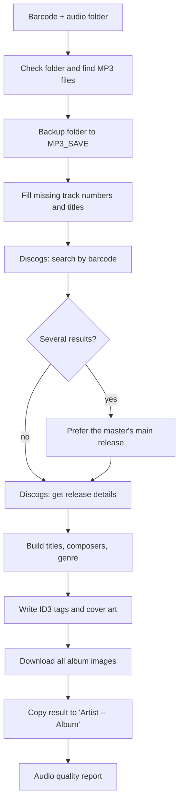

# Tagger GUI – Discogs Audio Tagger

Tagger GUI is a small desktop application that **automatically tags your MP3 albums** using the [Discogs](https://www.discogs.com) music database.

You give it the **barcode** printed on the back of a CD and the **folder** that contains the ripped MP3 files. It finds the album on Discogs, then writes the correct artist, album, track titles, genre, year, composer and cover art into every file. It also shows you the resulting tags and the audio quality of each track in a table.

The project has two parts:

| File | Role |
|------|------|
| `src/tagger.py` | The engine. A command-line script that talks to Discogs and writes the ID3 tags. It can be used on its own. |
| `src/gui/tagger_gui.py` | The Qt6 graphical interface. It collects the parameters, runs `tagger.py` in the background, and displays the log, the tag table and the album images. |

---

## Table of contents

1. [Features](#features)
2. [How it works](#how-it-works)
3. [Prerequisites](#prerequisites)
4. [Installation and Python setup](#installation-and-python-setup)
5. [Getting a Discogs token](#getting-a-discogs-token)
6. [Usage](#usage)
7. [Parameters reference](#parameters-reference)
8. [What gets written to your files](#what-gets-written-to-your-files)
9. [Discogs API documentation](#discogs-api-documentation)
10. [Project layout](#project-layout)
11. [Security notes](#security-notes)
12. [Known limitations](#known-limitations)
13. [Troubleshooting](#troubleshooting)

---

## Features

- Finds an album on Discogs from its **barcode**, or from a **Release ID** you force manually.
- Writes ID3 tags: artist, album artist, album, title, genre, year, composer, barcode and Discogs web page.
- Embeds the **front cover** in every MP3 and downloads **all album images** into the folder.
- Handles **multi-disc albums**, **classical releases** with headings and sub-tracks, and optional **composer names in track titles**.
- Fills in missing track numbers and titles from the file names before tagging.
- **Makes a backup** of your folder before changing anything.
- Analyses the **audio quality** (bitrate and sample rate) of each MP3 and shows it with a colour code.
- The Discogs token is **never stored in the code**. It is read from an environment variable or typed in a dialog box.

---

## How it works



In order, the script does the following:

1. Reads the parameters and gets the Discogs token.
2. Checks that the folder exists and contains MP3 files.
3. Sets read/write permissions on the files in the folder.
4. **Copies the original folder to `MP3_SAVE`** (next to your audio folder) so you can always go back.
5. Adds a track number and a title (taken from the file name) to any file that has no track number.
6. Searches Discogs for the barcode. If several releases match, it uses the main release of the matching *master* release, or otherwise the first valid release. You can override this with `-r`.
7. Downloads the release details and compares the number of tracks on Discogs with the number of files, and warns you if they differ.
8. Builds the track titles. Headings and sub-tracks (common on classical albums) are added as a prefix. With `-c`, the composer is added in brackets.
9. Writes the tags and the cover into each file. Files are matched to Discogs tracks in **track-number order** (and disc number order for multi-disc albums).
10. Downloads every album image into the folder as `album_image_1.jpg`, `album_image_2.jpg`, and so on.
11. Prints a table of the final tags.
12. **Copies the tagged folder to `Artist -- Album`** (in the parent directory of your audio folder).
13. Reports the bitrate, sample rate and quality of every track.

---

## Prerequisites

| Requirement | Details |
|-------------|---------|
| **Python** | 3.10 or newer (the project was developed with 3.11). |
| **Operating system** | Linux is the reference platform (the helper script `run_tagger_gui.sh` is a Bash script). macOS and Windows should work when you run the Python files directly. |
| **Discogs account** | Free. Needed to generate a personal access token. |
| **Internet access** | To reach `api.discogs.com`. |
| **MP3 files** | One album per folder. Only `.mp3` files are tagged. |
| **Python packages** | `PyQt6`, `mutagen`, `requests`, `tabulate` (see below). |
| **Tkinter** *(optional)* | Used for the token dialog when you run `tagger.py` on its own. If it is missing, the script asks for the token in the terminal instead. |

---

## Installation and Python setup

### 1. Get the code

```bash
git clone https://github.com/<your-user>/tagger_gui.git
cd tagger_gui
```

### 2. Create a virtual environment

A virtual environment keeps the project's libraries separate from the rest of your system.

**With the standard `venv` module:**

```bash
python3 -m venv venv_tagger
source venv_tagger/bin/activate        # Windows: venv_tagger\Scripts\activate
```

**Or with `pyenv` (what `run_tagger_gui.sh` expects):**

```bash
pyenv install 3.11.13
pyenv virtualenv 3.11.13 venv_tagger
pyenv activate venv_tagger
```

### 3. Install the dependencies

Create a `requirements.txt` file at the root of the project with this content:

```text
PyQt6
mutagen
requests
tabulate
```

Then install it:

```bash
pip install -r requirements.txt
```

### 4. Linux only: Qt system library

Recent versions of Qt 6 need one system library on Linux. On Debian or Ubuntu:

```bash
sudo apt install libxcb-cursor0
```

---

## Getting a Discogs token

The Discogs API requires authentication to download images and to avoid strict rate limits.

1. Log in to Discogs.
2. Open **Settings → Developers**: <https://www.discogs.com/settings/developers>
3. Click **Generate new token** and copy it.

Treat the token like a password. Do not commit it to Git or paste it into a public place.

### How the application finds your token

The token is looked up in this order, and the first one found is used:

| Order | Source | Applies to |
|-------|--------|-----------|
| 1 | The **Discogs Token** field in the GUI | GUI |
| 2 | The environment variable **`TOKEN_DISCOGS`** | GUI and `tagger.py` |
| 3 | A **dialog box** asking you to type it (hidden input) | GUI and `tagger.py` |

`tagger.py` also accepts the variable `DISCOGS_TOKEN`. The GUI uses it internally to pass the token to `tagger.py`.

If you cancel the dialog or leave the token empty, nothing runs and an error is shown.

---

## Usage

### Option A – Graphical interface (recommended)

**With the launcher script (Linux/macOS):**

```bash
# The token is asked in a dialog box
./run_tagger_gui.sh

# The token is taken from the environment, so no dialog box
TOKEN_DISCOGS="your_token_here" ./run_tagger_gui.sh
```

To avoid typing it each time, you can add this line to your `~/.bash_profile` (or `~/.bashrc`):

```bash
export TOKEN_DISCOGS="your_token_here"
```

The launcher loads `pyenv`, activates the `venv_tagger` environment, installs the dependencies from `requirements.txt` if needed, and starts the application.

**Or directly with Python:**

```bash
source venv_tagger/bin/activate
python src/gui/tagger_gui.py
```

**Using the window:**

1. Enter the **barcode** (required) and choose the **audio folder**.
2. Optionally set the genre, release ID, performer, or tick *Add the composer to the title*.
3. Click **▶ Exécuter Tagger**.
4. Follow the colour-coded log at the bottom. Errors are red, warnings orange.
5. When it finishes, the **track table** on the right and the **album images** on the left refresh automatically. Click an image thumbnail to open it full size.
6. The **Qualité** column is colour-coded from red (low) to green (excellent). *Rafraîchir tableau* reloads the table at any time.

### Option B – Command line

```bash
python src/tagger.py BARCODE -f "/path/to/album/folder" [options]
```

Examples:

```bash
# Simple case
python src/tagger.py 081227819781 -f "/home/me/Audio/MP3" --loglevel=DEBUG

# Barcodes with spaces must be quoted; add composer names to titles
python src/tagger.py "3 149020 949252" -f "/home/me/Audio/MP3" --compositeur

# Force genre, release and performer
python src/tagger.py "3 149020 949252" -f "/home/me/Audio/MP3" \
    --genre "Chanson Française" --release 30305858 --interprete "Michel Jonasz"
```

Use `python src/tagger.py --help` for the built-in help.

> **Important:** each run needs a **clean folder**. If `MP3_SAVE` (or the final `Artist -- Album` folder) already exists next to your audio folder, the script stops with an error instead of overwriting it. Rename or delete these folders before the next run.

---

## Parameters reference

| GUI field | Command line | Description |
|-----------|--------------|-------------|
| Barcode * | `BARCODE` (positional) | The album barcode (EAN/UPC). Required. |
| Dossier audio | `-f`, `--audio_folder` | Folder containing the MP3 files. The default is a personal path, so always set it yourself. |
| Niveau de log | `--loglevel` | `DEBUG`, `INFO` (default), `WARNING` or `ERROR`. |
| Ajouter le compositeur au titre | `-c`, `--compositeur` | Appends the composer to the track title, e.g. `Title (Composer)`, when Discogs has one. |
| Genre | `-g`, `--genre` | Forces the genre for the whole album. |
| Release ID | `-r`, `--release` | Forces a specific Discogs release. Accepts `30305858` or `[r30305858]`. |
| Interprète | `-i`, `--interprete` | Forces the artist name. |
| Discogs Token | *(environment)* | See [Getting a Discogs token](#getting-a-discogs-token). |

---

## What gets written to your files

### ID3 tags

| Tag | Source |
|-----|--------|
| `artist`, `albumartist` | First Discogs artist, or the value of `--interprete` |
| `album` | Release `title` |
| `title` | Track title, prefixed by heading/sub-track name when present, plus the composer with `-c` |
| `genre` | The `--genre` value if given. Otherwise the first Discogs genre, shown as `Classique` for *Classical* releases and `Baroque` when the style is *Baroque* |
| `date` | Release `year` |
| `composer` | Credits with the role *Composed By*, *Written-By* or *Author* |
| `barcode` | The barcode you entered |
| `website` | Discogs page of the release |
| Cover picture | First image of the release (front cover) |

### Extra files and folders

| Item | When | Purpose |
|------|------|---------|
| `MP3_SAVE/` | Before any change | Backup of the original files |
| `album_image_N.jpg` | After tagging | All images of the release, saved inside the audio folder |
| `Artist -- Album/` | At the end | Copy of the tagged album with a clean name (`/` in names is replaced by `-`) |

---

## Discogs API documentation

The project uses the public **[Discogs REST API](https://www.discogs.com/developers/)**. All requests are `GET` requests to `https://api.discogs.com` and return JSON.

### Authentication and headers

Every request is authenticated with a **personal access token**, in two ways at once:

- an HTTP header: `Authorization: Discogs token=<YOUR_TOKEN>`
- a query parameter: `?token=<YOUR_TOKEN>` (on the search call and the image downloads)

Discogs requires a descriptive **`User-Agent`** header, so the script always sends one. All requests use a timeout of 10 seconds to connect and 30 seconds to read.

### Endpoints used

| # | Endpoint | Used for | Called from |
|---|----------|----------|-------------|
| 1 | `GET /database/search` | Find releases from a barcode | `main()` |
| 2 | `GET /masters/{master_id}` | Resolve a *master* release into its main release | `select_release()` |
| 3 | `GET /releases/{release_id}` | Get the full details of one release | `get_release_data()` |
| 4 | Image URLs returned by `/releases/{id}` | Download the cover and every album image | `download_cover_art()`, `download_image()` |

#### 1. Search by barcode

```text
GET https://api.discogs.com/database/search?barcode=081227819781&page=1
```

Only the `resource_url` field of each result is kept. It points either to a release (`.../releases/123`) or to a master (`.../masters/456`).

#### 2. Master release (only if the barcode matches several results)

```text
GET https://api.discogs.com/masters/456
```

The field `main_release_url` gives the preferred release. If no master gives a usable result, the first valid standard release is used.

#### 3. Release details

```text
GET https://api.discogs.com/releases/123
```

If you pass `-r 123`, the search is skipped for the choice of release and this URL is used directly.

Fields of the response that the tagger reads (simplified):

```jsonc
{
  "title": "Album title",
  "year": 1998,
  "uri": "https://www.discogs.com/release/123-...",   // web page of the release
  "artists": [ { "name": "Artist name" } ],
  "genres": ["Electronic"],
  "styles": ["Baroque"],
  "images": [ { "uri": "https://i.discogs.com/..." } ], // first one = cover
  "tracklist": [
    {
      "type_": "track",                 // "track", "heading" or "index"
      "title": "Track title",
      "extraartists": [ { "name": "Composer", "role": "Composed By" } ]
    },
    {
      "type_": "index",                 // a work split into movements
      "title": "Work title",
      "sub_tracks": [ { "title": "I. Allegro" }, { "title": "II. Adagio" } ]
    }
  ]
}
```

How the `tracklist` is interpreted:

| `type_` | Meaning | How it is used |
|---------|---------|----------------|
| `track` | A normal track | Counts as one file and gives one title |
| `heading` | A section title (e.g. a work or a disc name) | Not a track. Its title is added as a prefix to the following titles |
| `index` | A work divided into movements | Each entry of `sub_tracks` counts as one file. The index title is used as a prefix |

#### 4. Images

Image addresses come from the `images` list of the release. The cover is downloaded once to embed it in the MP3 files. Then every image is saved in the audio folder. Downloading images requires an authenticated request.

### Quick test with `curl`

You can check your token and a barcode without running the application:

```bash
curl -H "Authorization: Discogs token=YOUR_TOKEN" \
     -H "User-Agent: MyTaggerTest/1.0" \
     "https://api.discogs.com/database/search?barcode=081227819781"
```

### Rate limits and errors

- Discogs limits the number of requests per minute (about 60 for authenticated requests). A normal album uses only a handful of calls plus one call per image, so the limit is rarely a problem. If you tag many albums in a row, leave a short pause between them.
- If the **search** call does not return HTTP 200 (for example `401` for an invalid token), the script logs the status code and stops.
- If a **release** call fails, the error is printed and the script stops with a message that no data was found.
- If an **image** download fails, it is logged and the script continues without that image.

For the official reference, see:

- Database search: <https://www.discogs.com/developers/#page:database,header:database-search>
- Release: <https://www.discogs.com/developers/#page:database,header:database-release>
- Master release: <https://www.discogs.com/developers/#page:database,header:database-master-release>
- Authentication and rate limiting: <https://www.discogs.com/developers/#page:authentication>

---

## Project layout

The code expects this layout (the GUI looks for `tagger.py` one folder above itself, and for the icon in `img/`):

```text
tagger_gui/
├── run_tagger_gui.sh        # Launcher (pyenv + venv + dependencies)
├── requirements.txt         # Python dependencies
├── README.md
├── img/
│   └── icone2.png           # Application icon
└── src/
    ├── tagger.py            # Command-line tagging engine
    └── gui/
        └── tagger_gui.py    # Qt6 graphical interface
```

The GUI starts `tagger.py` as a separate process and passes the token through an environment variable, so the token never appears in the command line or in the log.

---

## Security notes

- **Never commit your token.** If a token was ever written in a file that you shared or pushed to Git, generate a new one on the Discogs developer page and revoke the old one.
- **Do not share `DEBUG` logs.** At the `DEBUG` level, the script logs the full search URL, which contains the token in its query string. Use `INFO` when you copy logs into a bug report.
- A `.gitignore` file is recommended:

  ```text
  __pycache__/
  *.pyc
  .pip_installed
  .env
  venv*/
  .vscode/
  ```

---

## Known limitations

- Only **MP3** files are tagged (the script lists `.flac` and `.m4a` as audio extensions, but tagging and sorting work on MP3 only).
- Files are matched to Discogs tracks by **track number**, so a wrongly numbered file will receive the wrong title. The script warns you when the number of files and the number of Discogs tracks differ.
- The barcode search reads **only the first page** of results.
- One folder must contain **one album**.
- The default audio folder in the command line and in the GUI is a personal path. Set your own each time, or edit it in the code.
- The log messages of `tagger.py` are partly in French.

---

## Troubleshooting

| Problem | Likely cause and fix |
|---------|----------------------|
| `401` error in the log | The token is wrong or empty. Generate a new one and try again. |
| "Le dossier de sauvegarde existe déjà" | `MP3_SAVE` or `Artist -- Album` already exists. Delete or rename it, then run again. |
| "Pas de release trouvé avec ce barcode" | The barcode is not on Discogs, or is written differently. Find the release on the Discogs website and pass its ID with `-r`. |
| The number of files does not match the number of Discogs tracks | The release found is not the right edition. Try another release ID with `-r`. |
| Wrong genre | Use `-g` to force the value. |
| The window does not open on Linux (`xcb` error) | Install the system library: `sudo apt install libxcb-cursor0`. |
| `run_tagger_gui.sh` says the virtualenv is not found | Create it with `pyenv virtualenv 3.11.13 venv_tagger`, or adapt `VENV_NAME` and `PYTHON_VERSION` at the top of the script. |
| No token dialog appears when running `tagger.py` alone | Tkinter is not installed. The token is then requested in the terminal. |

---

## Credits

Album data and images are provided by [Discogs](https://www.discogs.com). This project is not affiliated with or endorsed by Discogs. Please follow the [Discogs API Terms of Use](https://support.discogs.com/hc/en-us/articles/360009334593-API-Terms-of-Use).
